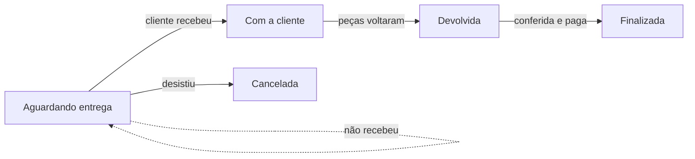

# O que é o CondicionalMap

**Condicional** é quando a loja envia peças para a cliente experimentar em casa. Ela fica com o que gostou, devolve o resto e paga só pelo que ficou. É uma prática comum em lojas de roupa, e quase sempre é controlada no caderno, na memória ou no WhatsApp.

O CondicionalMap organiza esse ciclo inteiro num lugar só, pensado para ser usado **no celular**, no balcão ou na rua.

## O que a loja consegue fazer

| Tarefa | Onde |
|---|---|
| Cadastrar clientes (só nome e WhatsApp são obrigatórios) | [Clientes](#pt-clientes) |
| Montar uma sacola, por quantidade ou peça por peça | [Nova condicional](#pt-nova-condicional) |
| Ver no mapa onde estão as sacolas e em que situação | [Mapa das sacolas](#pt-mapa) |
| Registrar o que a cliente escolheu e conferir o que voltou | [Escolha e conferência](#pt-escolha-conferencia) |
| Registrar pagamentos, inclusive parciais | [Pagamentos e fechamento](#pt-pagamentos) |
| Acompanhar vendas, conversão e pendências | [Painel](#pt-painel) |
| Consultar o histórico de cada sacola | [Ciclo da condicional](#pt-ciclo) |

## O ciclo em uma imagem

## Princípios

- **Simples primeiro.** Poucos campos obrigatórios. A gerente da loja valida o que faz sentido na rotina, e o sistema cresce a partir disso.
- **A escolha da cliente não fecha a venda.** Quem fecha é a loja, depois de conferir fisicamente o que voltou.
- **Números reais.** O painel é calculado a partir das condicionais registradas, nunca de exemplos.
- **Dados de cliente são privados.** Endereço e telefone só aparecem para a equipe da loja, depois do login.

> **Atenção:** o CondicionalMap **registra** pagamentos, mas não processa cobranças. Pix, cartão e dinheiro continuam sendo recebidos pelos meios que a loja já usa.

## Para quem é esta documentação

- **Gerente e equipe da loja:** as seções *Uso diário* explicam cada tela, com casos de uso e solução de problemas.
- **Quem mantém o sistema:** as seções *Técnico* cobrem arquitetura, banco de dados, segurança e instalação.
