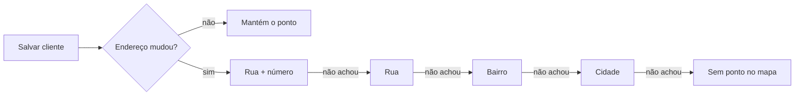

# Mapa das sacolas

## Para que serve

Ver de relance a logística do dia: o que ainda precisa ser entregue, o que está com clientes, o que passou do prazo e onde a entrega não deu certo. O mapa abre centralizado na **Grande Florianópolis**, mas funciona em qualquer lugar do Brasil.

## Como funciona

Cada sacola vira um marcador redondo **com o número da condicional dentro**, posicionado no endereço da cliente.

| Cor | Situação | Quando acontece |
|---|---|---|
| 🔵 **Azul** | Aguardando entrega | A condicional foi criada e ainda não chegou à cliente. |
| 🟢 **Verde** | Recebido | A cliente está com a sacola, dentro do prazo. |
| 🟠 **Laranja** | Prazo vencido | A cliente está com a sacola e o prazo de devolução já passou. |
| 🔴 **Vermelho** | Não recebido | Houve tentativa de entrega e a cliente não recebeu. |

- Sacolas **devolvidas, finalizadas ou canceladas** não aparecem: elas já estão na loja.
- Tocar num marcador mostra a cliente, o número, as peças, o prazo e o link **Abrir condicional**.
- Os botões de legenda acima do mapa **filtram** por cor e mostram quantas sacolas há em cada situação.
- Marcador com **borda tracejada** = local aproximado (o sistema achou o bairro ou a rua, mas não o número).
- A roda do mouse só dá zoom depois de clicar no mapa, para não atrapalhar a rolagem da página.

### De onde vem a localização

Quando a cliente é salva com endereço, o servidor converte o endereço em coordenada usando o OpenStreetMap (Nominatim). Ele tenta, nesta ordem: rua e número → rua → bairro → cidade, e para no primeiro resultado. A consulta acontece **só quando o endereço muda**, nunca a cada tecla.

### "Cliente não recebeu"

Na condicional aguardando entrega existe o botão **Cliente não recebeu**, com um campo opcional ("ninguém em casa"). A sacola fica vermelha até:

- **Nova tentativa de entrega**: volta para azul; ou
- **Cliente recebeu**: vira verde, e o registro de "não recebido" é apagado automaticamente.

Tudo fica no histórico da condicional.

## Caso de uso

> O entregador sai com quatro sacolas. Ele volta dizendo que a Carla, no Campeche, não estava em casa. A atendente abre a condicional da Carla, toca em **Cliente não recebeu** e escreve "ninguém em casa". No mapa, o ponto do Campeche fica vermelho. No dia seguinte, antes de sair, a gerente filtra o mapa por **Não recebido** e vê o que precisa voltar para a rota.

## Problemas comuns

> **Problema:** A cliente não aparece no mapa.
> Abaixo do mapa aparece "X sacolas não aparecem porque a cliente está sem endereço". Abra a ficha da cliente → **Editar** → preencha pelo menos o **bairro e a cidade** e salve.

> **Problema:** O ponto está no lugar errado ou no centro da cidade.
> O endereço não foi encontrado com precisão e o sistema usou o bairro ou a cidade (borda tracejada). Confira a grafia da rua e do bairro e salve de novo. Nomes populares ("Kobrasol") costumam funcionar, mas abreviações ("R.", "Av.") às vezes não.

> **Problema:** Ao salvar, aparece "o endereço não foi encontrado no mapa".
> A cliente foi salva normalmente; só o ponto não foi criado. Pode ter sido erro de digitação ou o serviço de mapas fora do ar. Tente salvar de novo mais tarde.

> **Problema:** "Não foi possível carregar o mapa agora."
> O navegador não conseguiu baixar os mapas do OpenStreetMap (internet instável ou rede bloqueando). O resto do painel continua funcionando.
