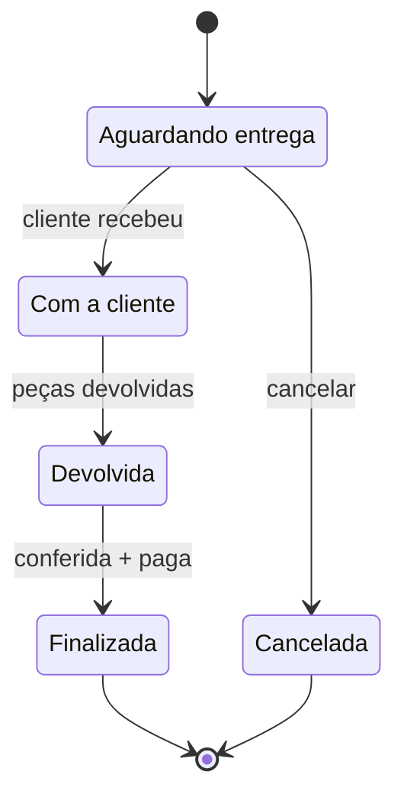

# Ciclo da condicional

## Para que serve

Garantir que nenhuma sacola seja dada como encerrada antes de a loja **receber e conferir** as peças, e que cada passo fique registrado.

## Como funciona

| Etapa | Significado | Ação para avançar |
|---|---|---|
| **Aguardando entrega** | Sacola montada, ainda na loja ou a caminho. | Código da cliente na entrega (ou **Cliente recebeu**) |
| **Com a cliente** | A cliente está experimentando. Ela escolhe pelo link ou a loja registra. | Código da coleta (ou **Peças devolvidas**) |
| **Devolvida** | As peças voltaram. A loja confere e registra pagamentos. | **Finalizar condicional** |
| **Finalizada** | Encerrada: nada mais muda. | — |
| **Cancelada** | Desistência antes da entrega. | — |

### Regras que o sistema garante

Essas regras ficam **no banco de dados**, então valem mesmo se a tela tiver algum erro:

- Não dá para pular etapas (por exemplo, de "Aguardando entrega" direto para "Finalizada").
- A sacola não sai sem peças.
- Peças só entram, saem ou mudam de preço enquanto a sacola está **aguardando entrega**.
- Finalizar exige **conferência** e pagamento que cubra o valor final, ou uma **justificativa** de saldo em aberto.
- Com uma entrega ou coleta **em andamento**, a etapa só avança pelo **código da cliente** (ou pela confirmação manual da gerente). Veja [Entregas, coletas e página da cliente](#pt-entregas).
- Finalizada ou cancelada, a condicional fica **travada**, inclusive os pagamentos.

### Número e histórico

Cada condicional ganha um número sequencial por loja (`#0001`, `#0002`…). O **Histórico**, na lateral da condicional, mostra quem fez o quê e quando: criação, cada mudança de etapa, escolha, conferência, pagamentos e tentativas de entrega.

### Prazo vencido

Se a sacola está **com a cliente** e a data de "Devolver até" já passou, ela aparece como **Prazo vencido**: na lista, no card do painel, em "Precisa de atenção" e em laranja no mapa.

## Caso de uso

> A Daniela recebeu a sacola na terça, com prazo até sexta. No sábado, a condicional dela aparece como **Prazo vencido**. A atendente manda mensagem pelo botão do WhatsApp. No domingo, a Daniela devolve na loja e a atendente toca em **Peças devolvidas**. A condicional passa para "Devolvida" e sai do mapa.

## Problemas comuns

> **Problema:** "Essa mudança de etapa não é permitida."
> A ação não corresponde à etapa atual (por exemplo, duas pessoas mexendo na mesma condicional ao mesmo tempo). Atualize a página para ver a etapa real.

> **Problema:** "Adicione pelo menos uma peça antes de enviar."
> Em condicionais peça por peça, adicione as peças. Por quantidade, informe a quantidade e toque em **Salvar** antes de **Cliente recebeu**.

> **Problema:** Errei e marquei "Peças devolvidas" antes da hora.
> Por segurança, as etapas não voltam. Registre a situação nas observações. Se isso acontecer com frequência, avise: dá para criar uma ação de "desfazer" com justificativa.

> **Problema:** Não consigo cancelar.
> Só dá para cancelar enquanto a sacola está **aguardando entrega**. Depois que a cliente recebeu, as peças precisam voltar e ser conferidas.
