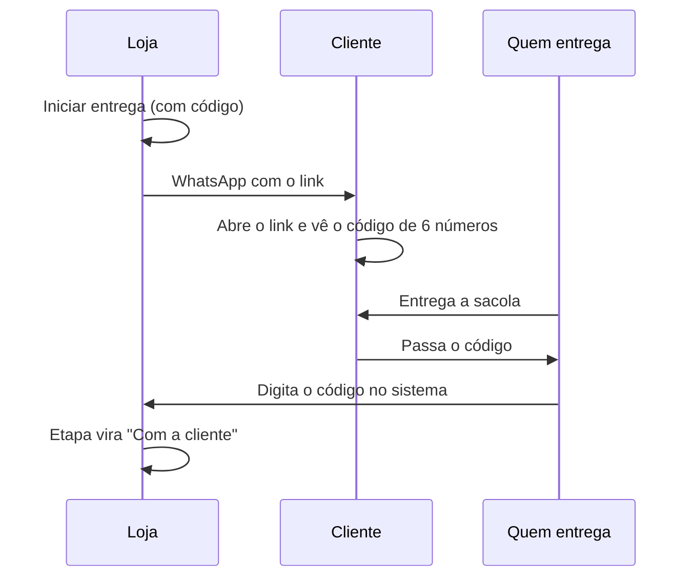

# Entregas, coletas e página da cliente

## Para que serve

- **Página da cliente:** a cliente abre um link no celular, vê as peças, marca o que fica e envia. Sem conta, sem senha.
- **Entrega e coleta com código:** quem leva a sacola (ou busca a devolução) só consegue dar a tarefa como feita se a cliente passar um **código de 6 números**. Ao digitar o código, a etapa da condicional muda sozinha no sistema.

Assim a loja tem a prova de que a cliente **realmente recebeu** (ou devolveu), sem depender de "palavra de entregador".

## Como funciona

### Página da cliente (`/c/`)

1. Na condicional, toque em **Enviar link da escolha** (ou **Enviar código à cliente**). O sistema gera um link novo e abre o WhatsApp com a mensagem pronta; é só apertar enviar.
2. A cliente abre o link. Ela vê as peças e o total.
3. Marca **Vou ficar** ou **Devolver** em cada peça (ou escolhe a quantidade) e toca em **Enviar minha escolha**.
4. Pode **alterar** quantas vezes quiser, até a loja conferir a devolução.

Regras importantes:

- **Enviar a escolha não fecha a venda.** A loja confere as peças e só a conferência vale para o valor final.
- O link **expira em 14 dias** e um link novo **cancela o anterior**.
- O link é a única credencial: guarda-se só o **hash** dele; nada pessoal aparece no endereço.
- Na condicional da loja aparece "A cliente enviou a escolha em…", e a escolha já vem preenchida nas peças.

### Entrega com código

1. Na condicional **Aguardando entrega**, toque em **Iniciar entrega (com código)**.
2. Toque em **Enviar código à cliente**. A mensagem leva o **link**; o código aparece **na página da cliente**, não na mensagem.
3. Quando a cliente receber a sacola, ela passa o código a quem entregou.
4. Quem entregou digita o código na própria condicional ou na tela **Entregas** e toca em **Confirmar entrega**.
5. O sistema muda a etapa para **Com a cliente** e registra no histórico "Entrega confirmada com o código da cliente".

### Coleta da devolução

Igual à entrega, mas na etapa **Com a cliente**: **Buscar devolução (com código)**. Ao confirmar, a etapa vira **Devolvida**. Se a cliente prefere levar à loja, use **Peças devolvidas na loja**, sem código.

### Tela "Entregas"

Lista tudo que está em andamento (entregas e coletas), com endereço, referência e um campo para digitar o código na hora. É a tela para usar na rua, no celular.

### Regras do código

| Regra | Valor |
|---|---|
| Tamanho | 6 números |
| Uso | Único: ao confirmar, a tarefa fecha |
| Validade | 48 horas |
| Tentativas | 5 erros e o código **trava** |
| Código novo | **Gerar código novo** zera as tentativas e o anterior deixa de valer |
| Quem vê o código | **Só a cliente.** A equipe nunca vê |
| Sem o código | Só a **gerente**, com motivo obrigatório, em **Confirmar sem código** |

Com uma entrega ou coleta em andamento, **não dá para avançar a etapa pelo botão comum**: só pelo código ou pela confirmação manual da gerente. Se a cliente não recebeu, use **Cliente não recebeu**: a sacola fica **vermelha no mapa**.

## Caso de uso

> A Daniela pediu a condicional pelo WhatsApp. A atendente toca em **Iniciar entrega** e **Enviar código à cliente**. A Daniela recebe o link, e o motoboy chega. Ela abre o link, vê **482 913**, pega a sacola e diz o código. O motoboy digita na tela **Entregas**: a condicional passa para **Com a cliente**. Na quarta, a Daniela abre o mesmo link, marca as 2 peças que fica e envia; a atendente vê a escolha pronta.

## Problemas comuns

> **Problema:** "Código incorreto. Restam 3 tentativas."
> Peça à cliente para conferir o código na página dela. Depois de 5 erros ele trava.

> **Problema:** "Tentativas esgotadas" ou "O código expirou."
> Toque em **Gerar código novo** e reenvie o link. O código antigo deixa de valer.

> **Problema:** A cliente diz que o link não abre ("Este link não é válido ou já expirou").
> O link venceu (14 dias) ou foi substituído por um mais novo. Toque em **Enviar código à cliente** (ou **Enviar link da escolha**) de novo.

> **Problema:** A cliente não tem celular para ver o código.
> A gerente usa **Confirmar sem código** e escreve o motivo. Fica registrado com o nome dela no histórico.

> **Problema:** "Há uma entrega ou coleta em andamento."
> Com a tarefa aberta, a etapa só avança pelo código. Cancele a tarefa se quiser registrar de outro jeito.

> **Problema:** O WhatsApp não abriu sozinho.
> O navegador bloqueou a nova janela. Permita pop-ups para o site e toque de novo.
