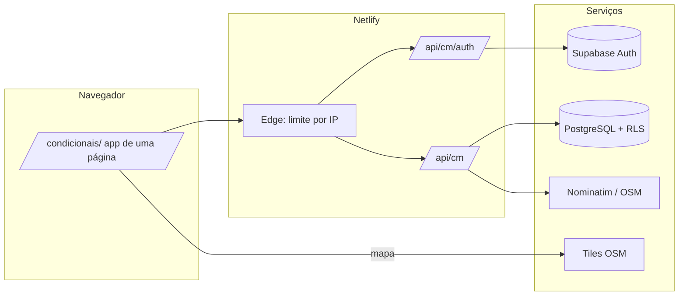
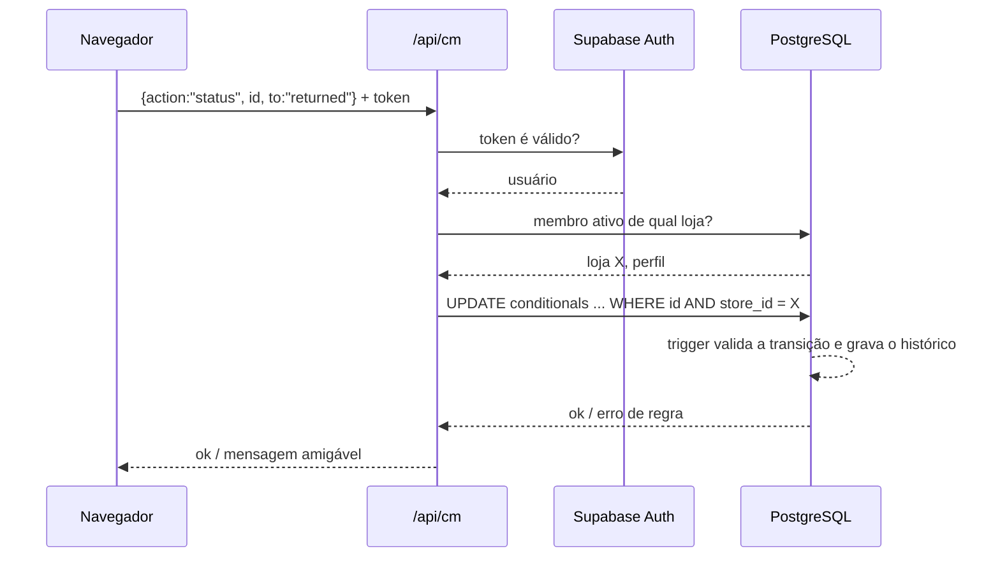

# Arquitetura

## Visão geral

Sem framework e sem etapa de build no site: HTML, CSS e JavaScript modernos. O servidor são **Netlify Functions** em Node, sem dependências. O banco é **Supabase (PostgreSQL)**.

**Regra central:** o navegador **nunca** fala com o banco. Ele só conhece o próprio token de sessão. Toda leitura e escrita passa pelas funções, que validam a pessoa e a loja a cada chamada.

## Função de cada parte

| Arquivo | Papel |
|---|---|
| `public/condicionais/index.html` | Casca da área da loja (`noindex`). |
| `public/condicionais/cm.js` | App inteiro: login, rotas por `#`, painel, mapa, listas, formulários e diálogos. Monta o DOM com `textContent`; `innerHTML` só para ícones constantes. |
| `public/condicionais/cm.css` | Paleta ateliê, componentes, versão celular (barra inferior, cards deslizantes). |
| `netlify/functions/cm-auth.mjs` | `login`, `refresh` (renova a sessão) e `me`. |
| `netlify/functions/cm.mjs` | Todas as operações da loja, por `action`: `dashboard`, `customers`, `customer_save`, `conditional_create`, `status`, `selection`, `review`, `payment_add`, `delivery_failed`… |
| `netlify/lib/store-auth.mjs` | Login da equipe e `requireMember()`: valida o token no Supabase Auth e a pessoa ativa em `store_members`. |
| `netlify/lib/cm-geocode.mjs` | Endereço → coordenada (Nominatim), com preferência pela Grande Florianópolis. |
| `netlify/lib/db.mjs`, `http.mjs`, `ratelimit.mjs` | Acesso REST ao banco com a chave secreta, respostas e erros, limite de tentativas. |
| `supabase/migrations/*condicionais*.sql` | Tabelas, regras (triggers) e travas de acesso. |
| `tools/create-member.mjs` | Cria loja e pessoas da equipe, troca senha, desativa acesso. |
| `tests/integration/condicionais.test.mjs` | Testes das regras do banco. |

## Fluxo de uma ação

## Decisões

- **Regras no banco, não só na tela.** Transições, valores e travas são triggers do PostgreSQL. Um bug no JavaScript não consegue fechar uma venda errada.
- **Loja vem do login.** Nenhuma operação aceita `store_id` vindo do navegador.
- **Sem dependências no servidor.** `fetch` puro: menos superfície de ataque, deploy rápido.
- **Mapa reaproveitado.** Leaflet servido pelo próprio site (`/vendor`), tiles do OpenStreetMap; a CSP não precisou mudar.
