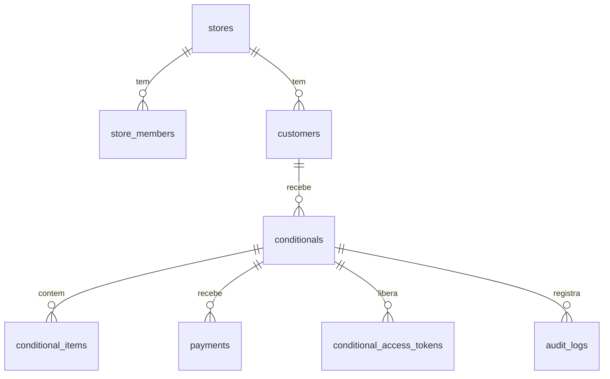

# Banco de dados

PostgreSQL do Supabase, com SQL versionado em `supabase/migrations/`.

## Tabelas

| Tabela | Responsabilidade |
|---|---|
| `stores` | Loja. `next_number` gera o número sequencial das condicionais. |
| `store_members` | Pessoas da equipe por loja, com perfil `admin` ou `staff`. |
| `customers` | Clientes. Nome e telefone obrigatórios; endereço e coordenada opcionais. |
| `conditionals` | A sacola: modo, etapa, quantidades, valores, prazo e datas de cada etapa. |
| `conditional_items` | Peças, só no modo peça por peça: `selected_qty` (escolha) e `sold_qty` (conferência). |
| `payments` | Pagamentos registrados. |
| `conditional_access_tokens` | Links da cliente: só o **hash** do token, com validade e revogação. |
| `delivery_tasks` | Entregas e coletas: tipo, situação, versão do código, tentativas e validade. O **código não é gravado**. |
| `audit_logs` | Histórico e auditoria numa tabela só. |



## Isolamento por loja

Toda tabela operacional tem `store_id`. As filhas referenciam **`(id, store_id)`** da mãe, com chave estrangeira composta. Por isso é **impossível** ligar a condicional de uma loja ao cliente de outra, mesmo com um bug no servidor.

## Regras automáticas (triggers)

| Regra | Erro quando quebrada |
|---|---|
| Só as transições do [ciclo](#pt-ciclo) | `invalid_transition` |
| Nasce em `preparing` | `invalid_initial_status` |
| Não sai sem peças | `no_items` |
| Finalizar exige conferência | `not_reviewed` |
| Finalizar exige pagamento ou justificativa | `payment_pending` |
| Encerrada não muda | `conditional_closed` |
| Peças só mudam em `preparing` | `items_locked` |
| Escolha só com a cliente ou devolvida | `selection_locked` |
| Conferência só depois da devolução | `review_locked` |
| "Não recebido" só antes da entrega | `delivery_failed_locked` |

Além disso, os triggers:
- calculam `total_items`, `sent_value`, `selected_items`, `sold_items` e `final_value` no modo peça por peça;
- gravam `audit_logs` na criação e em cada mudança de etapa;
- limpam o "não recebido" quando a cliente recebe.

O servidor traduz esses códigos em mensagens para a equipe (veja [Solução de problemas](#pt-solucao-de-problemas)).

## Migrações

| Arquivo | Conteúdo |
|---|---|
| `20261116000000_condicionais.sql` | Tabelas, regras, travas de acesso. |
| `20261116010000_condicionais_mapa.sql` | Coordenadas da cliente e "não recebido". |

```bash
npx supabase migration up --local   # banco local (Docker)
npx supabase db push                 # produção (nunca roda seed)
```

> **Atenção:** nunca rode migrações destrutivas em produção sem backup. As migrações do CondicionalMap só **criam** tabelas e colunas; nenhuma tabela existente é apagada.
